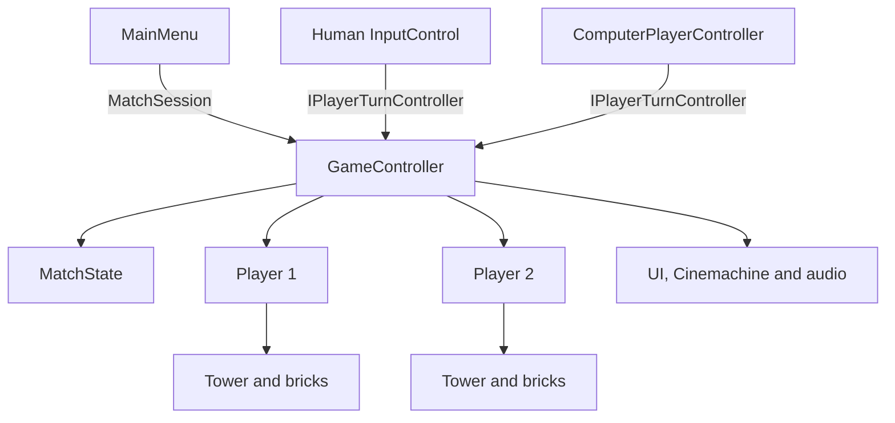

# TowerWar architecture

## Goals

TowerWar supports two match modes:

- **Human vs. computer**: one human controls Player 1 and the computer controls Player 2.
- **Human vs. human**: two joined `PlayerInput` instances control the two players.

The gameplay rules must remain testable without loading a Unity scene. Scene objects are adapters for input, presentation, physics, audio, and camera behaviour.

## Runtime overview



## Assemblies

### `TowerWar.Core`

Location: `Assets/Core`

This assembly contains deterministic match rules and calculations:

- `MatchState` owns the active player, current phase, and winner.
- `MatchPhase` describes selection, aiming, projectile, and finished states.
- `MatchMode` distinguishes solo and local multiplayer matches.
- `MatchSession` carries the selected mode from `MainMenu` to `Level1`.
- `ShotCalculator` converts angle and charge into a shot vector.

Core code must not reference scene objects or concrete input devices. `ShotCalculator` uses Unity's `Vector2` and `Mathf`, but has no dependency on `MonoBehaviour`.

### Scene gameplay scripts

Location: `Assets/Scripts`

- `GameController` is the composition root for a match. It initializes players, creates the required turn controllers, advances `MatchState`, and updates presentation components.
- `IPlayerTurnController` is the common boundary for human and computer control.
- `InputControl` adapts Unity Input System callbacks to match commands.
- `ComputerPlayerController` performs the same select-and-fire commands without simulating keyboard input.
- `Player` owns one catapult, its selectable tower blocks, and the defeat signal.
- `Brick` owns collision damage and its one-time removal notification.
- `MatchConfiguration` is an optional ScriptableObject for shot and AI tuning. Existing scenes use safe defaults until an asset is assigned.

## Match lifecycle

1. `MainMenu` starts a join flow.
2. Two joined players start `HumanVsHuman` automatically.
3. After Player 1 joined, pressing **C** starts `HumanVsComputer`.
4. Opening `Level1` directly defaults to `HumanVsComputer`.
5. `GameController` initializes both `Player` components and selects controllers based on `MatchSession.Mode`.
6. A turn advances through `SelectingBlock`, `Aiming`, and `ProjectileInFlight`.
7. A falling catapult reports death once; `MatchState` records the winner and enters `Finished`.
8. Returning to `MainMenu` destroys old match input objects. The menu's `PlayerInputManager` is scene-bound, preventing duplicate managers.

## Controller contract

Every turn controller implements:

```csharp
public interface IPlayerTurnController
{
    void BeginTurn(Player player, GameController gameController);
    void EndTurn();
}
```

Controllers may decide *how* to produce commands, but only `GameController` may mutate the match state. This keeps input, AI, and rules separate.

## Configuration

Create a tuning asset through **Assets → Create → TowerWar → Match Configuration** and assign it to `GameController.matchConfiguration` in a level scene. If no asset is assigned, the controller preserves the former gameplay values:

- maximum shot force: `10000`
- minimum shot charge: `0.2`
- rotation speed: `90 degrees/second`
- computer think time: `0.8 seconds`

Tower layout values remain on `ProcTower` for now. They should move to a `TowerConfiguration` asset when multiple tower types or levels need independent tuning.

## Tests

Edit-mode tests live in `Assets/Tests/EditMode`.

- `MatchStateTests` verify turn transitions, invalid transitions, and the winner state.
- `ShotCalculatorTests` verify direction, force, and charge clamping.
- `SceneConfigurationTests` verify build-scene order, required scene objects, serialized references, and missing scripts.

Play-mode smoke tests live in `Assets/Tests`:

- `MatchLifecycleTests` verifies that a solo level creates the computer controller.
- It also verifies that loading `MainMenu` repeatedly leaves exactly one `PlayerInputManager`.

Physics outcomes should be covered by a small number of tolerant play-mode tests. Exact tower-collapse positions should not be asserted because solver results can vary across Unity and physics-engine versions.

## Extension rules

### Adding another level

1. Create the scene and add it to Build Settings.
2. Provide two `Player` objects and one `GameController`.
3. Assign UI, camera target group, music, and optionally a `MatchConfiguration`.
4. Add the scene to `SceneConfigurationTests`.

### Improving the computer player

Replace only the decision logic inside `ComputerPlayerController` or introduce another `IPlayerTurnController`. Do not add artificial keyboard or gamepad events. Candidate improvements include projectile trajectory sampling, vulnerable-block scoring, difficulty-dependent aim noise, and waiting for physics to settle before ending a turn.

## Known next steps

- Replace the remaining `GameObject.Find("Player1")`/`("Player2")` compatibility lookup with serialized player references after updating `Level1` in the editor.
- Introduce a dedicated `Tower` component so `Player` no longer searches child bricks directly.
- Move scene names into a central scene catalogue or build-index abstraction.
- Extend play-mode coverage to exercise real device joins for menu → solo match → menu and menu → two-player match.
- End a turn after projectile motion settles instead of immediately after firing.
